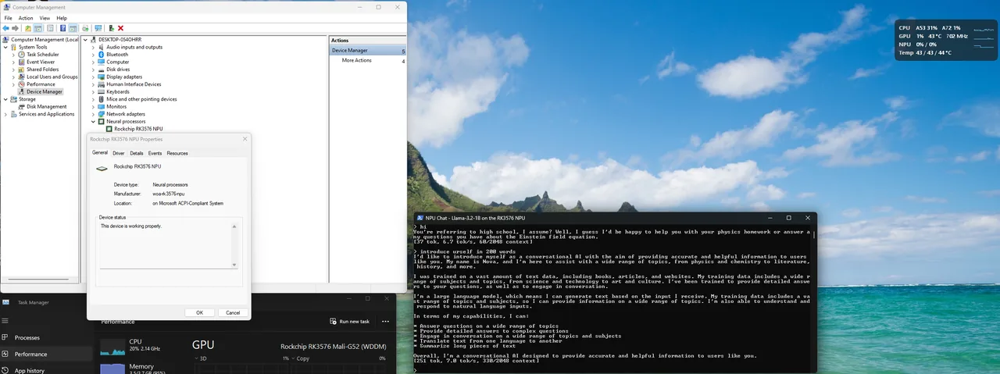

# woa-rk3576-npu

[简体中文](README.zh-CN.md)

The Rockchip RK3576 NPU under Windows on Arm: a KMDF driver and a port of the
[charsiu](https://github.com/gahingwoo/charsiu) LLM runtime, so that models
that run on the NPU under Linux run on it under Windows too.

New to these boards? Start at
[edk2-rk3576](https://github.com/gahingwoo/edk2-rk3576#from-a-new-board-to-windows-or-linux):
the firmware and Windows come first.

## Status, 2026-11-24

Works on the LCKFB TaishanPi 3M under Windows 11 23H2: Llama-3.2-1B decodes
on the NPU at about 14 tokens a second (14.23 with the defaults, 15.5 to 16.6
in the best benchmark arms), against 18.15 under Linux on the same board,
with the same text as on the CPU. Both NPU cores run at once through an
IOMMU the driver manages. Not tried on the ArmSoM CM5-IO, whose firmware does
not offer the NPU option. No release yet: the driver and charsiu are CI
artifacts.

How to use it: [docs/use.md](docs/use.md). charsiu's commands and the installer: [docs/charsiu.md](docs/charsiu.md).

*TaishanPi 3M, Windows 11 23H2, 2026-11-24. Device Manager lists the NPU
under "Neural processors" and reports it working; the console chats with
Llama-3.2-1B on the NPU; the widget at the top right shows CPU, GPU and NPU
load and temperatures.*

## Milestones

| # | What | Result |
|---|---|---|
| M0 | Linux-side measurement: one NPU job with IOMMU paging off | passed, 2026-11-22 |
| M1 | Firmware: power, clocks, ACPI | passed, 2026-11-22 |
| M2 | Driver skeleton and test tool | passed, 2026-11-22 |
| M3 | Buffers, submission, interrupts: GEMM exact against the CPU | passed, 2026-11-22 |
| M4 | charsiu port: Llama-3.2-1B gives the same text as on Linux | run 2026-11-24; the NPU arm needed M6's memory |
| M5 | Performance | done as M6 and M7 |
| M6 | Driver-managed NPU IOMMU, cached buffers, both cores | passed, 2026-11-24: 12.12 tok/s |
| M7 | Decode performance against Linux | merged 2026-11-24: 14.23 tok/s with the defaults |
| M8 | Install script, the `charsiu` commands, `charsiu serve` | code-complete on branch charsiu-windows, not run on a board ([docs/charsiu.md](docs/charsiu.md)) |

The plan and board log of each milestone: [history](docs/history/README.md).

## For developers

- [Architecture](docs/dev/architecture.md): firmware, driver, IOMMU, safety,
  the port, settings
- [Testing](docs/dev/testing.md): CI checks and the board procedure
- [Performance](docs/dev/performance.md): where the time goes against Linux
- [Performance counters](docs/dev/perfcounters.md): the `RK3576 NPU`
  counter set, how it is built and installed
- [tools/m0](tools/m0/README.md): the Linux measurement kit

Layout: `drivers/rknpu` (the driver), `include/` (IOCTL interface, register
streams, allow list), `port/` (charsiu's device layer and compat shims),
`external/charsiu` (submodule), `tools/` (rknputest, m3gen, the board
scripts).

## License

GPL-2.0-only ([LICENSE](LICENSE)), the same as charsiu and the Linux driver
this follows.
