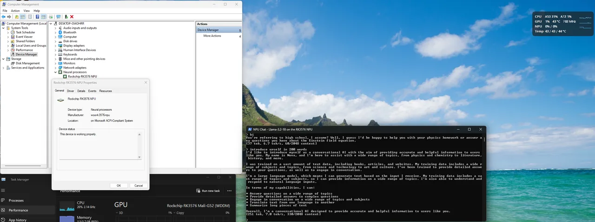

# woa-rk3576-npu

[English](README.md)

在 Windows on Arm 上使用 Rockchip RK3576 的 NPU：一个 KMDF 驱动（`rknpu.sys`），加上 [charsiu](https://github.com/gahingwoo/charsiu) 大模型运行时的移植，让在 Linux 上能用 NPU 跑的模型，在 Windows 上也能跑。

第一次接触这些板子？请从 [edk2-rk3576](https://github.com/gahingwoo/edk2-rk3576/blob/main/README.zh-CN.md) 开始：先装好固件和 Windows。

## 状态

| 功能 | 状态 |
|---|---|
| 驱动、两个 NPU 核心、驱动管理的 IOMMU | 板测通过（泰山派 3M） |
| charsiu 在 NPU 上运行，`charsiu_run` | 板测通过（泰山派 3M） |
| 性能计数器（`RK3576 NPU`） | 板测通过（泰山派 3M） |
| SUBMIT 分阶段计时（`rknputest submit-stats`） | 仅 CI |
| `charsiu` 命令、`charsiu serve`、安装脚本 | 仅 CI |
| ArmSoM CM5-IO | 没试过：它的固件没有 NPU 选项 |

还没有正式版：驱动和 charsiu 都是 CI 产物。

## 结果

立创泰山派 3M，Windows 11 23H2，2026-11-26，风扇开启：Llama-3.2-1B-Instruct Q8_0 默认设置下解码 **16.12 tok/s**（每个 token 62.0 ms），是同一块板子在 Linux 下 18.15 tok/s 的 89%。基准测试的每一组输出文字都相同。更多数据见[性能](docs/dev/performance.md)（英文）。

*泰山派 3M，2026-11-24："Neural processors"下的 NPU、在 NPU 上用 Llama-3.2-1B 对话，以及显示 CPU、GPU、NPU 负载的 rk-monitor。*

## 文档

- [使用](docs/zh-CN/use.md)：打开 NPU、安装驱动、跑模型
- [Windows 上的 charsiu](docs/zh-CN/charsiu.md)：命令、安装脚本、谁能用 NPU
- 开发文档（英文）：[架构和设置](docs/dev/architecture.md)、[测试](docs/dev/testing.md)、[性能](docs/dev/performance.md)、[性能计数器](docs/dev/perfcounters.md)、[tools/m0](tools/m0/README.md)
- [历史](docs/history.md)（英文）：里程碑 M0 到 M8

## 许可证

GPL-2.0-only（[LICENSE](LICENSE)），与 charsiu 以及所参照的 Linux 驱动相同。
